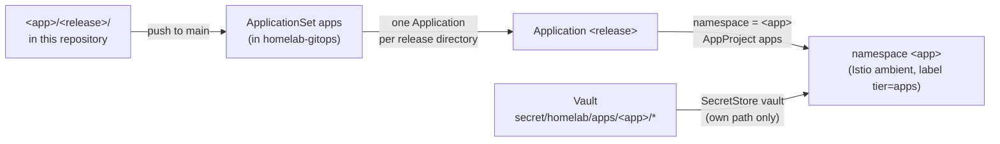

# homelab-gitops-apps

Workload applications of the StaffOps homelab. The platform they run on (Argo CD, Vault, Keycloak, Istio,
observability, PostgreSQL, backups) lives in [homelab-gitops](https://github.com/StaffOps/homelab-gitops); this
repository holds only the apps.

## How an app reaches the cluster



- Every directory inside an app directory is a **release** and becomes one Argo CD Application with the same name.
- The app's namespace is the app directory. It gets the label `staffops.space/tier=apps` and joins the mesh.
- Apps cannot touch the platform: no platform namespaces, no cluster-wide objects except their Namespace.
- Secrets: each app reads only `secret/homelab/apps/<its namespace>/*` from Vault.

## Layout

```
<app>/helmfile.yaml.gotmpl     one app = one namespace
<app>/<release>/               one directory per helmfile release = one Argo CD Application
_template/                     starting point for a new app (skipped by Argo CD)
environment.yaml               platform contract (domain, gateway, storage class)
scripts/render-app.sh          render and check an app like Argo CD does
```

## Add an app

```bash
cp -R _template my-app                 # then replace "my-app" everywhere
scripts/render-app.sh my-app           # must end with "✔ my-app renders"
git add my-app && git commit -m "feat(my-app): ..." && git push
```

Secrets, if the app needs any, are written in Vault by the operator
(`vault kv put secret/homelab/apps/my-app/<name> key=value`); the template already has the SecretStore and an
example ExternalSecret.

Rules for people and AI agents: [AGENTS.md](AGENTS.md). Requires `helmfile`, `helm` and `yq`.

## License

[MIT-0](LICENSE): use, copy, modify and redistribute freely, no attribution required, no warranty.
